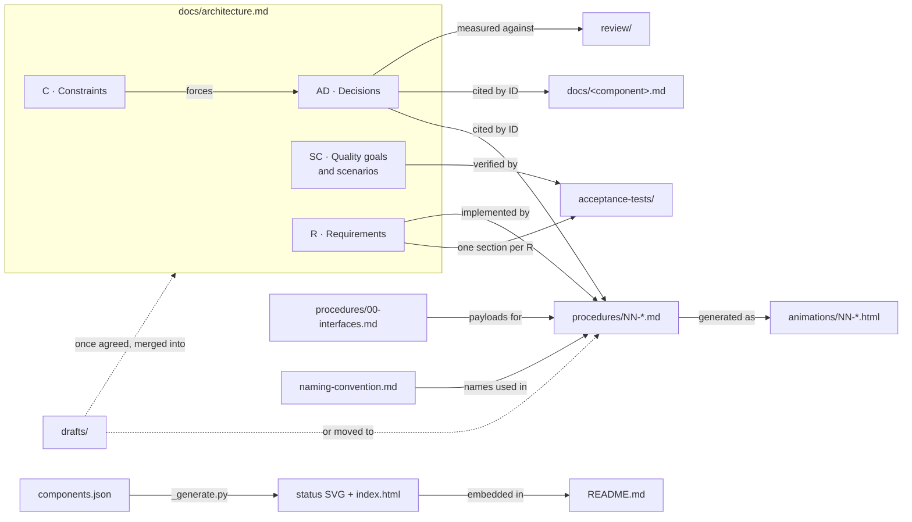
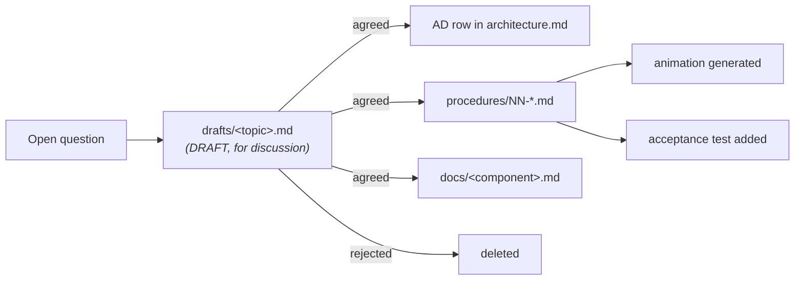

# arch-repo-scaffold

A Claude Code skill that generates a new architecture repository, modelled on
[kubevirt-workflows](https://github.com/Idan-Maimon/kubevirt-workflows). Every generated folder
has its own `README.md` with the detailed rules and an example; this page is the overview.

**Run it:** ask Claude to *"scaffold a new architecture repo for &lt;project&gt;"*, or type
`/arch-repo-scaffold`. To run the generator directly:

```bash
python3 scripts/scaffold.py --name "<Project name>" --dest <dir> [--id 70] [--pages-url https://owner.github.io/repo]
```

Instructions for Claude are in [SKILL.md](SKILL.md).

---

## Layout produced

```
<repo>/
├── README.md                        ① Front page: status diagram + documents table
├── .gitignore
│
├── acceptance-tests/                ② How the delivered system is accepted
│   ├── README.md
│   └── acceptance-tests.md
│
└── docs/                            ③ The architecture itself
    ├── README.md
    ├── architecture.md                 the entry point: R, SC, C, AD, risks, context, glossary
    ├── naming-convention.md            names, scopes, labels
    ├── <component>.md                  one spec per component we build (added later)
    │
    ├── procedures/                  ④ One file per operational procedure
    │   ├── README.md                   index by layer + the procedure file format
    │   ├── 00-interfaces.md            every external call, with real payloads
    │   └── NN-verb-object.md           (added later)
    │
    ├── animations/                  ⑤ Generated step-by-step HTML, one per procedure
    │   └── README.md
    │
    ├── implementation-status/       ⑥ Generated build-status diagram
    │   ├── README.md
    │   ├── components.json             ← the only file you edit
    │   ├── _generate.py
    │   └── status-light.svg · status-dark.svg · index.html   (generated)
    │
    ├── images/                      ⑦ Static diagrams, source beside render
    ├── drafts/                      ⑧ Proposals not yet agreed
    └── review/                      ⑨ Assessments of work produced elsewhere
```

---

## How the pieces connect



The requirement IDs in `architecture.md` are what holds the repo together. Acceptance tests are
grouped by requirement, procedures carry out requirements, and every decision is cited by its ID
wherever it applies.

---

## Folder by folder

| # | Folder | Holds | Written by | Lifecycle |
|---|---|---|---|---|
| ① | `/` | Front page: status picture, one row per top-level document | Hand | Updated when a document is added |
| ② | `acceptance-tests/` | Test spec per requirement, evidence documents per run | Hand | Spec stable; evidence per run |
| ③ | `docs/` | Agreed architecture, naming, component specs | Hand | Authoritative |
| ④ | `docs/procedures/` | Trigger, inputs, step table with failure handling, idempotency, gaps | Hand | Authoritative |
| ⑤ | `docs/animations/` | Self-contained HTML walkthroughs | **Generated** by `_generate.py` | Regenerate, never hand-edit |
| ⑥ | `docs/implementation-status/` | Components by lane, coloured by status | **Generated** from `components.json` | Edit JSON, regenerate, commit both |
| ⑦ | `docs/images/` | Rendered diagrams with their source | Hand + render | Delete when nothing links to it |
| ⑧ | `docs/drafts/` | Options and recommendations awaiting a decision | Hand | Temporary: merge then delete |
| ⑨ | `docs/review/` | Pinned assessments of external branches or designs | Hand | Frozen once written |

---

## A document's life



---

## ID scheme

IDs are stable and **never renumbered or reused**. When something is removed, its number stays
empty.

| Prefix | Meaning | Lives in | Example |
|---|---|---|---|
| `R` | Requirement (a business operation) | architecture §1 | `R1` OCP cluster creation |
| `SC` | Quality goal / `SCn.m` scenario | architecture §2 | `SC3.1` Resiliency |
| `C` | Constraint (a fact you cannot change) | architecture §3 | `C7` Live migration needs shared storage |
| `AD` | Architectural decision, with its reason | architecture §5 | `AD16` No overcommit |
| `R` | Risk (separate table) | architecture §6 | `R2` Seed failure in a zone |
| `P` `M` `U` `D` | Acceptance test: provisioning, modification, upgrade, deletion | acceptance-tests | `P2` Create a hosted cluster |
| `NN` | Procedure number | procedures | `04` Update NodePool |

---

## Conventions

- **File and folder names** are lowercase kebab-case. Procedures are named `NN-verb-object.md`.
- **Headings** use `## N :: Title`. Procedure titles use `# NN :: Title`.
- **Generated files** have a `_generate.py` next to them. Edit the source, re-run it, and commit
  the source and output together.
- **Cross-references** cite IDs ("per AD16") rather than restating the reasoning.
- **Drafts** end their title with `(DRAFT, for discussion)` and end the file with `## To discuss`.
- **Reviews** record the repo, branch, commit and date they assessed, and say what they did not
  check.
